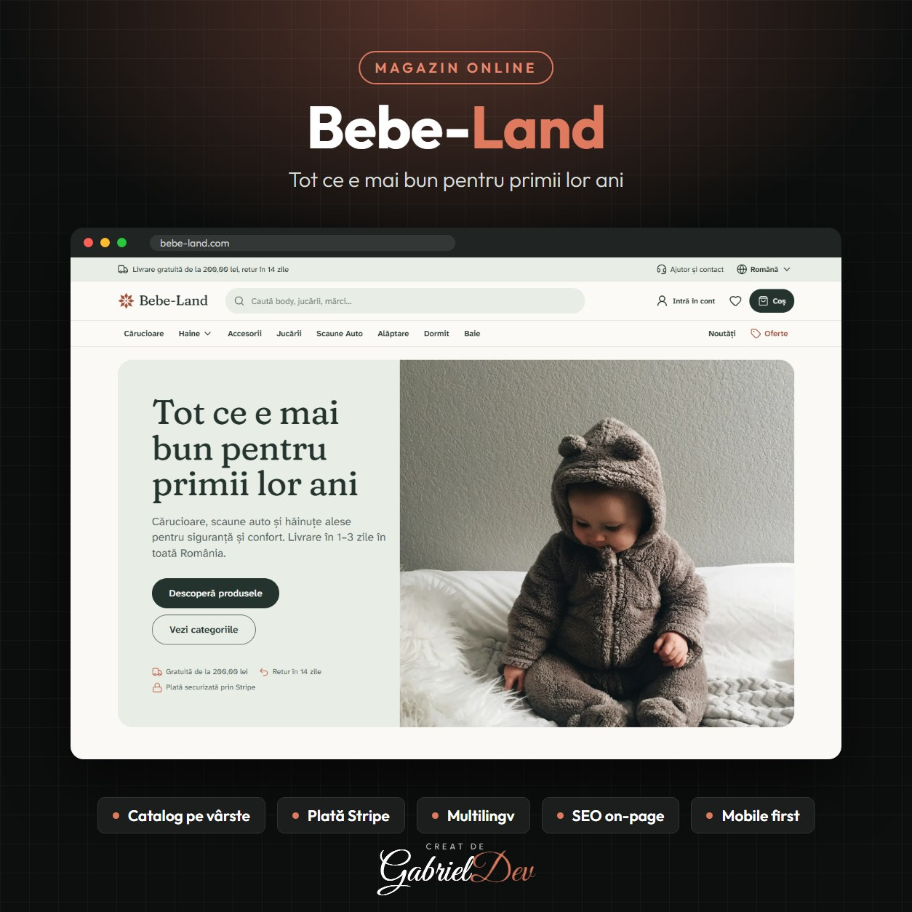

  

<h1 align="center">Bebe-Land – Magazin Online pentru Bebeluși și Copii</h1>

Magazin online premium cu cărucioare, scaune auto, hăinuțe, jucării și accesorii pentru bebeluși, organizat pe vârste, cu plată securizată prin Stripe și livrare în toată România.

  
  
  
  
  

| | |
|---|---|
| **Client** | Bebe-Land |
| **An** | 2026 |
| **Domeniu** | Magazin online · Backend Development · Frontend Development |
| **Status** | Live — [bebe-land.com](https://bebe-land.com) |
| **Portofoliu** | [gabrieldev.eu](https://gabrieldev.eu/proiecte) |

---

## Despre proiect

Bebe-Land este un **magazin online pentru bebeluși și copii**, construit de GabrielDev pentru părinți care vor produse sigure, alese cu grijă. Catalogul acoperă cărucioare, scaune auto, haine, accesorii, jucării, alăptare, somn și baie, iar navigarea pornește de la vârsta copilului: 0–3 luni, 3–12 luni, 1–5 ani și 5+ ani.

## Funcționalități implementate

- Catalog organizat pe categorii și pe vârsta copilului
- Căutare rapidă după produse, mărci și categorii
- Coș și checkout cu plată securizată prin **Stripe**
- Favorite și cont de client
- Secțiuni de oferte, noutăți și „preferatele părinților”
- Site multilingv: română, engleză și norvegiană
- Ghiduri pentru părinți: mărimi, livrare, retururi, întrebări frecvente
- Panou de administrare în **Filament** pentru produse, comenzi și conținut
- Design Mobile First și SEO on-page pe categorii și produse
- Pagini legale și informații de protecție a consumatorului (ANPC, SOL)

## Tehnologii

Laravel 11 · PHP 8.2 · Filament 3 · Tailwind CSS · Alpine.js · Vite · Stripe

---

## 🔒 Despre cod

Acesta este un repository de **prezentare**. Codul sursă aparține clientului și nu este public — aici găsești descrierea proiectului, funcționalitățile și tehnologiile folosite.

## 🤝 Ai nevoie de ceva asemănător?

Proiect realizat de **[Gabriel Dev](https://gabrieldev.eu)** — creare site-uri, magazine online și aplicații web personalizate.

- 🌐 [gabrieldev.eu](https://gabrieldev.eu) · [toate proiectele](https://gabrieldev.eu/proiecte)
- ✉️ [contact@gabrieldev.eu](mailto:contact@gabrieldev.eu)
- 📞 [+40 743 543 100](tel:+40743543100)
